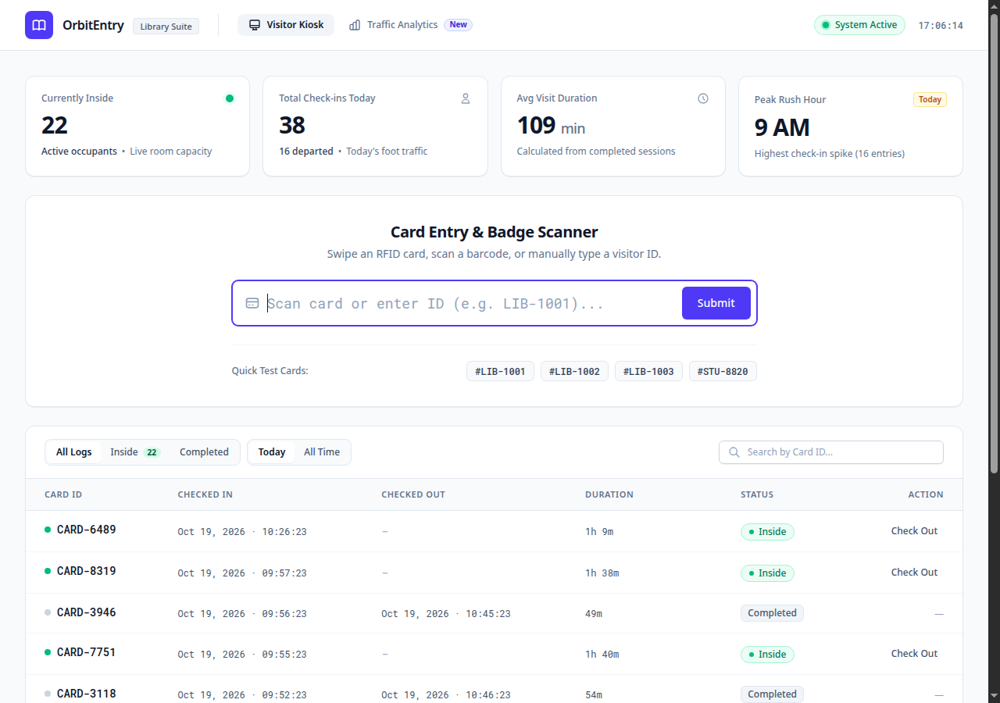
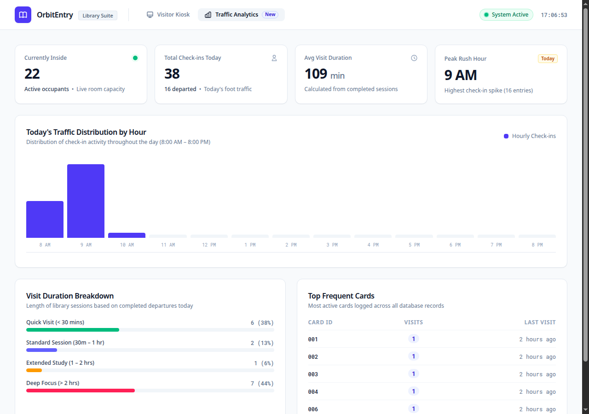

# OrbitEntry 🚀

[](https://laravel.com)
[](https://www.php.net/)
[](https://livewire.laravel.com)
[](https://tailwindcss.com)
[](#automated-testing)
[](LICENSE)

**OrbitEntry** is a lightweight, hardware-ready Visitor Management and Attendance Kiosk designed for libraries, universities, reading rooms, and public facilities. 

Operating entirely on an efficient **single-table architecture**, it provides instant check-in/out toggling via RFID or barcode scanners, synthesized audio feedback, real-time occupancy metrics, progressive loading, and traffic analytics.

---

## 📸 Product Previews

### 1. Visitor Kiosk & Live Audit Log
*Stripe-inspired interface with autofocus input, live occupancy counters, quick-test chips, and progressive record expansion.*



### 2. Traffic Analytics Dashboard
*Hourly distribution charts, visit duration cohorts, and frequent card leaderboards calculated dynamically from log records.*



---

## ✨ Key Features

- **⚡ Smart Scan & Auto-Toggle:** Automatically detects whether an arriving card requires check-in or check-out based on open sessions. Zero staff interaction required.
- **🔊 Web Audio API Synthesizer:** Real-time audio feedback (major chime on Check-In, descending tone on Check-Out, error buzz on empty entry) without external `.mp3` assets.
- **📊 Real-time Metric Cards:**
  - **Currently Inside:** Live room count with active occupancy badge.
  - **Total Check-ins Today:** Foot traffic counter paired with completed departure tally.
  - **Average Visit Duration:** Dynamically calculated from completed visits.
  - **Peak Rush Hour:** Automatically detects peak traffic spikes during operating hours.
- **📜 Progressive "See More" Loading:** Smooth, infinite-style record expansion without full-page reloads or layout shifts.
- **🔍 Instant Filtering & Search:** Debounced card search with status filters (`Inside`, `Completed`, `All Logs`) and date ranges (`Today`, `All Time`).
- **📈 Traffic Analytics Dashboard:** Visual hourly traffic breakdown (8:00 AM – 8:00 PM), visit length cohort progress bars, and top visitor leaderboards.
- **🏷️ Hardware Scanner Ready:** Autofocuses and processes inputs from USB/Bluetooth handheld barcode and RFID badge readers natively.

---

## 🗄️ Database Architecture & Koha ILS Multi-Connection

OrbitEntry utilizes a clean **Multi-Database Architecture**:

1. **Primary Database (`visits` table)**: OrbitEntry's internal database (SQLite or MySQL/PostgreSQL) strictly stores entry/exit timestamps and card transactions.
2. **Secondary Database (`borrowers` table - Read-Only)**: OrbitEntry connects to an external **Koha Integrated Library System (ILS)** database. When an ID card is scanned, OrbitEntry looks up patron information (Student/Staff full name, department, branch) without storing redundant copies.

```
       [ Student / Staff Scans ID Card ]
                      │
                      ▼
         ┌─────────────────────────┐
         │       OrbitEntry        │
         │     (Visitor Kiosk)     │
         └────────────┬────────────┘
                      │
        ┌─────────────┴─────────────┐
        │ Reads Patron Details      │ Writes Check-In/Out
        ▼ (SELECT only)             ▼ (INSERT / UPDATE)
 ┌──────────────┐            ┌──────────────┐
 │   Koha DB    │            │ OrbitEntry DB│
 │ (borrowers)  │            │   (visits)   │
 └──────────────┘            └──────────────┘
```

#### OrbitEntry `visits` schema:
```sql
CREATE TABLE visits (
    id INTEGER PRIMARY KEY AUTOINCREMENT,
    cardnumber VARCHAR(255) NOT NULL,
    checked_in DATETIME NOT NULL,
    checked_out DATETIME NULLABLE,
    created_at DATETIME,
    updated_at DATETIME
);
```

#### Configuring the Koha Database Connection
In `.env`:
```env
# Koha Database Connection
DB_KOHA_DRIVER=mariadb
DB_KOHA_HOST=127.0.0.1
DB_KOHA_PORT=3306
DB_KOHA_DATABASE=koha_aec
DB_KOHA_USERNAME=koha_reader
DB_KOHA_PASSWORD=secret
```
*Note: If the Koha database is not configured or offline, OrbitEntry automatically falls back gracefully and continues recording visits by card number.*

### Indexed Columns
- `cardnumber` (fast scan lookup)
- `checked_in` (instant daily range & hourly queries)
- `checked_out` (active occupant filtering)

---

## 🚀 Getting Started

### Prerequisites
- **PHP:** `^8.3` (with `pdo_sqlite` extension enabled)
- **Composer:** `^2.0`
- **Node.js:** `^20.0` & `npm`

### Installation

1. **Clone the repository:**
   ```bash
   git clone https://github.com/dhananj001/OrbitEntry.git
   cd OrbitEntry
   ```

2. **Install PHP and Node dependencies:**
   ```bash
   composer install
   npm install --legacy-peer-deps
   ```

3. **Configure Environment:**
   ```bash
   cp .env.example .env
   php artisan key:generate
   ```

4. **Initialize SQLite Database & Run Migrations:**
   ```bash
   touch database/database.sqlite
   php artisan migrate
   ```

5. **Build Frontend Assets:**
   ```bash
   npm run build
   ```

6. **Start the Development Server:**
   ```bash
   php artisan serve --port=8000
   ```
   Open [http://127.0.0.1:8000](http://127.0.0.1:8000) in your browser.

---

## 🧪 Testing

The repository includes a comprehensive feature test suite covering page rendering, check-in, check-out toggling, audio event dispatching, and manual desk actions:

```bash
php artisan test
```

### Generating Test Data
To populate the database with realistic visitor activity and test the analytics views:

```bash
php artisan tinker --execute '
for ($i = 1; $i <= 30; $i++) {
    \App\Models\Visit::create([
        "cardnumber" => "CARD-" . rand(1000, 9999),
        "checked_in" => now()->subMinutes(rand(10, 300)),
        "checked_out" => rand(0, 1) ? now()->subMinutes(rand(1, 9)) : null,
    ]);
}
echo "30 sample visits generated successfully!" . PHP_EOL;
'
```

---

## 🏗️ Codebase Overview

| Path | Purpose |
| :--- | :--- |
| `app/Models/Visit.php` | Eloquent model with casts, duration accessor, and query scopes |
| `app/Livewire/VisitorKiosk.php` | Reactive controller managing scan routines, filters, and analytics |
| `resources/views/livewire/visitor-kiosk.blade.php` | Stripe-grade dashboard view, charts, and audio synthesizer |
| `database/migrations/*create_visits_table.php` | Single-table schema definition with performance indexes |
| `tests/Feature/VisitorKioskTest.php` | Automated PHPUnit feature test suite |

---

## 📄 License
This project is open-sourced under the [MIT license](LICENSE).
